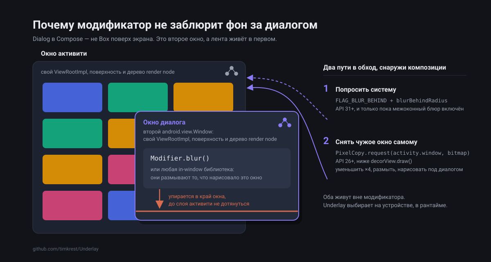
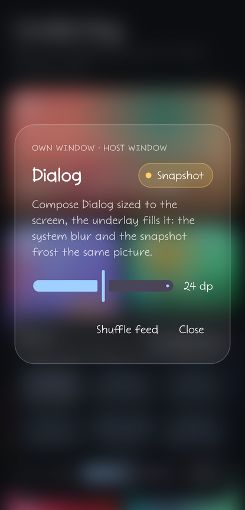
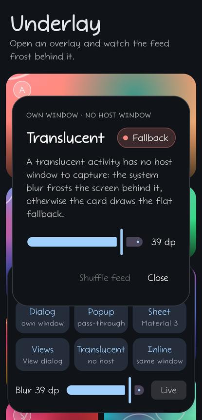

# Как заблюрить фон за диалогом в Compose, начиная с API 23

[English](article-window-boundary.md)

Дизайнер прислал макет: карточка поверх ленты, под карточкой матовое стекло. Я повесил
`Modifier.blur()`, и диалог заблюрил сам себя: содержимое карточки поплыло, а лента за ней
осталась резкой.

Переставил модификаторы местами, обернул всё в `Box`, перенёс модификатор на родителя. Ничего не
поменялось.

Compose тут ни при чём. Диалог — отдельное окно, и дальше я расскажу, что это за граница и как её
обойти, начиная с API 23.

## Почему модификатор не достаёт до фона

`Dialog` в Compose — не `Box` поверх экрана. Это `android.view.Window`: отдельное окно со своим
`ViewRootImpl`, своей поверхностью и своим деревом render node. Композиция диалога живёт внутри
этого окна. Лента, которую вы хотите заблюрить, живёт в окне активити.

In-window блюр работает со слоем: модификатор помечает поддерево, библиотека забирает то, что оно
нарисовало, и размывает. `Modifier.blur()`, Cloudy и imla делают это внутри того окна, где живёт
модификатор, — слой окна активити им не принадлежит.

Границу можно перейти иначе: перенести через неё свою же запись. Так делает haze — записывает
поддерево, помеченное `hazeSource`, и проигрывает запись под эффектом уже в окне диалога. Это
работает, когда фон — ваше Compose-дерево, которое есть чем пометить. Когда за окном View-иерархия,
чужой экран или оверлей, который вообще не подкомпозиция этого экрана, помечать нечего — и граница
возвращается.



В Google про это знают, в трекере висит issue:
[Support window blur in compose dialogs](https://issuetracker.google.com/issues/296272625).

Значит, чинить надо снаружи композиции. Вариантов два:

1. попросить систему заблюрить всё, что за окном, — `FLAG_BLUR_BEHIND`;
2. снять содержимое чужого окна в bitmap и заблюрить его самому.

Первый дешевле. Второй работает там, где первый не работает.

## Ступень первая: система

`FLAG_BLUR_BEHIND` — старый флаг. Лет десять он числился deprecated и не делал ничего, а в API 31
его вернули и добавили к нему `blurBehindRadius`. Система блюрит всё, что за окном, живьём, на GPU,
и приложению это не стоит ничего. Платит SurfaceFlinger.

У диалога есть `Window`, и флаг ставится прямо на него:

```kotlin
window.addFlags(WindowManager.LayoutParams.FLAG_BLUR_BEHIND)
window.attributes = window.attributes.apply { blurBehindRadius = radiusPx }
```

У `Popup` нет объекта `android.view.Window`, но с точки зрения `WindowManager` это отдельное окно:
root view заходит через `addView` вместе с `WindowManager.LayoutParams`. Поля те же самые, только
пропихивать их надо через `updateViewLayout`:

```kotlin
val params = rootView.layoutParams as WindowManager.LayoutParams
params.flags = params.flags or WindowManager.LayoutParams.FLAG_BLUR_BEHIND
params.blurBehindRadius = radiusPx
windowManager.updateViewLayout(rootView, params)
```

Межоконный блюр может выключиться прямо на ходу. Энергосбережение гасит его целиком:
`isCrossWindowBlurEnabled` становится `false`, и флаг перестаёт что-либо значить. Устройство то же,
API 31 никуда не делся, а блюра нет.

А некоторые производители не включают его вообще. У моего Galaxy S25 Ultra на Android 16, сентябрь
2026-го, `mBlurEnabled=false`, потому что One UI не выставляет
`ro.surface_flinger.supports_background_blur`. Это не энергосбережение и не настройка доступности,
свойство просто пустое, так что `FLAG_BLUR_BEHIND` на этом телефоне не делает ничего. Проверить
свой можно двумя командами, вот что отвечает S25:

```
$ adb shell getprop ro.surface_flinger.supports_background_blur

$ adb shell dumpsys window | grep mBlurEnabled
  mBlurEnabled=false
```

На Redmi 9C рядом с ним, Android 11, второй строки нет вообще: ниже API 31 переключать нечего, и
снимок там единственный вариант.

Система, правда, сообщает о переключении:

```kotlin
windowManager.addCrossWindowBlurEnabledListener { isEnabled -> ... }
```

и да, срабатывает это, пока оверлей открыт, прямо у пользователя на глазах.

## Ступень вторая: снимок чужого окна

Если система блюрить не будет, блюрим сами. Окно активити, дальше буду звать его хостом, на самом
деле доступно: модификатор из композиции диалога нарисовать его содержимое не может, но
`LocalActivity.current?.window` — обычная ссылка, которую можно просто взять.

`PixelCopy.request(window, bitmap, callback, handler)` копирует содержимое окна в bitmap.
Перегрузка для `Window` есть с API 26. Читает прямо с поверхности, так что hardware bitmap ему
безразличны.

Ниже API 26 остаётся только `decorView.draw(canvas)` в софтверный canvas, и у него есть подвох.
`draw()` кидает

```
IllegalArgumentException: Software rendering doesn't support hardware bitmaps
```

как только на экране появляется хоть одна картинка, декодированная в hardware bitmap, а именно так
по умолчанию делают Coil и Glide начиная с API 26. То есть на API 26+ он не спасёт: если
`PixelCopy` отказал, `draw()` на экране с картинками отвалится следом. Зато на API 23–25 он
работает, hardware bitmap там ещё нет.

### Что снимать и чем блюрить

Перед блюром снимок уменьшается в 4 раза. Блюрить полноэкранный bitmap незачем, результат всё равно
будет размытым, а уменьшение в 4 раза убирает из работы 94% пикселей.

Сам блюр зависит от уровня API:

- на API 31+ это `GraphicsLayer` с `BlurEffect`, то есть `RenderEffect` на GPU. Тот же API 31, что
  нужен системному блюру, и именно сюда попадают устройства, где система отказалась:
  энергосбережение гасит межоконный блюр, а `RenderEffect` внутри своего окна не трогает;
- ниже — три box-прохода на `Dispatchers.Default`. Три прохода дают приличное приближение
  гауссианы, а каждый проход — скользящее окно, так что стоимость O(1) на пиксель при любом
  радиусе.

`blurRadius` — тот же радиус, что принимают `blurBehindRadius` и `RenderEffect.createBlurEffect`. Оба
переводят его в сигму гауссианы одинаково, `sigma = 0.57735·radius + 0.5`, и Underlay делает так же:
снимок размывается с этой сигмой, уменьшенной под захват ×4, а на CPU она становится радиусом
бокса, три прохода которого дают ближайшую сигму:

```
boxRadius = (sqrt(4·sigma² + 1) − 1) / 2
```

с округлением к ближайшему соседу. Все три пути размывают один и тот же макет одинаково.

Box-проходы идут по премультиплицированным каналам. Если усреднять непремультиплицированные,
прозрачный сосед затягивает свой цвет в результат, и по краю полупрозрачного окна ползёт цветная
кайма.

## Пока снимка нет, и если его не будет

Между появлением оверлея и готовым снимком проходит граница кадра, `PixelCopy` и блюр. Если в этом
промежутке нарисовать сплошной цвет, получится вспышка. Поэтому пока снимок готовится, рисуется
только тинт: хост виден резким и потом уходит в размытие. Я считаю это отдельным состоянием, а не
заглушкой на время загрузки. Потом снимок проявляется за 200 мс.

Сплошной цвет появляется только если снять окно не удалось вовсе.

## Underlay

Всё вышеописанное я собрал в библиотеку.

```kotlin
implementation("com.timkrest:underlay:0.5.0")
```

```kotlin
Dialog(onDismissRequest = ::dismiss) {
    Box(
        modifier = Modifier
            .fillMaxSize()
            .blurredUnderlay(
                blurRadius = 16.dp,
                tint = Color.Black.copy(alpha = 0.3f),
                fallback = MaterialTheme.colorScheme.surface,
            ),
    ) {
        // содержимое диалога
    }
}
```

Оверлеи на View получают то же самое фоном своей корневой View, радиус в пикселях:

```kotlin
view.blurredUnderlay(
    blurRadius = 16f * resources.displayMetrics.density,
    tint = 0x4D000000,
    fallback = surfaceColor,
)
```

`minSdk 23`, Apache 2.0, [github.com/timkrest/Underlay](https://github.com/timkrest/Underlay).



Модификатор сам разбирается, из какого окна его вызвали и есть ли под ним окно-хост, и берёт
лучшее из доступного. Первая ступень выше — это `SystemBlur`, вторая — `Snapshot`:

| Источник | Требует | Чем платим |
| --- | --- | --- |
| `SystemBlur` | API 31+, своё окно, включённый межоконный блюр | ничем — для приложения |
| `Snapshot` | API 23+, доступное окно-хост | заморожен, либо на пару кадров позади с `liveSnapshot` |
| `Pending` | — | пока снимок готовится, рисуется только тинт |
| `Fallback` | — | сплошной цвет |

Какой источник выиграл, видно снаружи, через колбэк или как Compose-состояние:

```kotlin
val underlay = rememberUnderlayState()

Modifier.blurredUnderlay(
    blurRadius = 16.dp,
    tint = Color.Black.copy(alpha = 0.3f),
    fallback = MaterialTheme.colorScheme.surface,
    state = underlay,
    onSourceChange = { source -> ... },
)

// underlay.source — активный UnderlaySource
// underlay.refresh() — снять окно-хост заново
```

Логируйте его: так видно, сколько пользователей получают снимок вместо системного размытия.

## Кому что достаётся

| Вызвано из | Своё окно | Окно-хост | Лучший источник |
| --- | --- | --- | --- |
| `Dialog`, `AlertDialog` из Material 3 | окно диалога | окно активити | `SystemBlur` |
| `Popup`, `PopupWindow`, `DropdownMenu` | root view через `WindowManager` | окно активити | `SystemBlur` |
| `ModalBottomSheet` | своё окно | окно активити | `SystemBlur` |
| View-`Dialog`, `DialogFragment`, `BottomSheetDialog` | окно диалога | окно активити | `SystemBlur` |
| Прозрачная активити | окно активити | нет, под ней другая активити | `SystemBlur` |
| Оверлей внутри активити | нет | нет | `Fallback` |

Про последнюю строку: без своего окна окном-хостом оказалось бы окно самого вызывающего, и снимок
запёк бы оверлей в его собственный фон. Это случай для in-window библиотеки, и с Underlay она
нормально уживается: Underlay рисует фон из чужого окна, in-window библиотека — живой эффект поверх
своего.

У прозрачной активити своё окно есть, а хоста нет: под ней другая активити, и её `Window` взять
неоткуда, так что `PixelCopy` нечего копировать. Она проваливается из `SystemBlur` сразу в
`Fallback`, минуя `Snapshot`.



## Что можно потрогать

В `:sample` по одной кнопке на каждый вид окна (`Dialog`, `Popup`, шторка Material 3, `Dialog` на
View, прозрачная активити, обычный оверлей внутри окна) над сеткой из hardware bitmap. Бейдж
показывает, какой источник выиграл, слайдер меняет радиус.

Самое интересное делается руками: откройте оверлей на API 31+ и включите энергосбережение. Бейдж
переключается с `System blur` на `Snapshot`, а картинка не мигает, потому что снимок доезжает под
тинтом.

```bash
./gradlew :sample:installDebug
```

## Ограничения

Снимок по умолчанию заморожен. Он делается при открытии оверлея, ещё раз при смене конфигурации
(поворот, split-screen) и по вызову `refresh()`. Для списка, который скроллится под попапом, есть
`liveSnapshot = true`: окно хоста снимается заново при каждой его отрисовке, по одному захвату за
раз, так что фон отстаёт от хоста на пару кадров. Это `PixelCopy` и блюр на каждый кадр хоста, пока
он рисует, поэтому по умолчанию выключено.

`FLAG_BLUR_BEHIND` — флаг окна, поэтому `SystemBlur` блюрит всё, что за окном оверлея, а
`Snapshot` — только то, что под композаблом. Повесьте модификатор на композабл во весь оверлей, и
обе ступени нарисуют одно и то же.

Хост — всегда окно активити. Диалог поверх диалога снимет активити, а диалог между ними пропустит.
У `SystemBlur` такого шва нет.

Kotlin Multiplatform я не планирую. Граница эта чисто андроидная. На iOS блюр за view — дело UIKit
(`UIVisualEffectView`), а на десктопе нет ничего похожего на `FLAG_BLUR_BEHIND` и `PixelCopy`.
Переносить можно было бы только box-блюр, а это один небольшой файл.

До 1.0 публичный API может меняться, и changelog будет говорить, что писать вместо старого.

## Чего мне не хватает

Данных с чужих устройств. Ступень выбирается на телефоне пользователя, а у меня есть только S25
Ultra, Redmi 9C и эмуляторы, на которых CI гоняет API 23, 26, 28, 31 и 34.

Если поставите, напишите: какой у вас `minSdk`, что вернул `mBlurEnabled` и что показал
`onSourceChange`. Больше всего мне интересно, один ли One UI такой. Если межоконный блюр выключен и
на других флагманах, то `SystemBlur` — редкая удача, а снимок — то, что сегодняшние флагманы
получают на самом деле.

Ответы — [в этом треде](https://github.com/timkrest/Underlay/discussions/1).

- [github.com/timkrest/Underlay](https://github.com/timkrest/Underlay)
- [Issue в трекере Google](https://issuetracker.google.com/issues/296272625)
